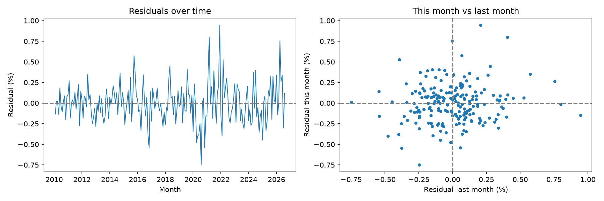

# Fama-French 5-Factor Model: S&P 500 (SPY)

A simple Python project that runs the Fama-French 5-factor regression on
the S&P 500 ETF (SPY) using real data.

## Model

$$
R_{SPY} - R_f = \alpha + \beta_1 (R_m - R_f) + \beta_2 SMB + \beta_3 HML + \beta_4 RMW + \beta_5 CMA + \varepsilon
$$

| Factor | Meaning |
|---|---|
| Mkt-RF | Market return minus the risk-free rate |
| SMB | Small minus Big (size) |
| HML | High minus Low book-to-market (value) |
| RMW | Robust minus Weak (profitability) |
| CMA | Conservative minus Aggressive (investment) |

## Data

- **Factors:** [Kenneth French Data Library](https://mba.tuck.dartmouth.edu/pages/faculty/ken.french/data_library.html) (monthly, US)
- **SPY prices:** Yahoo Finance via `yfinance` (adjusted for dividends and splits)
- **Sample:** 2010-02 to 2026-08 (199 months)

## How to run

```bash
python3 -m venv .venv
source .venv/bin/activate
pip install -r requirements.txt
python3 ff5_model.py
```

## Results

| | Coefficient | p-value |
|---|---|---|
| Alpha (const) | -0.0086 | 0.630 |
| Mkt-RF | 0.9874 | 0.000 |
| SMB | -0.1171 | 0.000 |
| HML | 0.0225 | 0.002 |
| RMW | 0.0462 | 0.000 |
| CMA | 0.0206 | 0.056 |

R-squared: **0.997**

## Interpretation

- **Market (0.99):** SPY moves almost one-to-one with the market.
- **Size (-0.12):** Negative loading, meaning a tilt toward large-cap stocks.
- **Profitability (0.05):** Small tilt toward profitable firms, consistent with
  the S&P 500's positive-earnings requirement for inclusion.
- **Value (0.02) and Investment (0.02):** Very small; close to neutral.
- **Alpha (-0.0086%/month):** Not significant. The small negative value is
  roughly in line with SPY's expense ratio.

**Summary:** SPY behaves like the market, with a mild tilt toward large and
profitable companies, and no significant alpha.

## Residual diagnostics

Durbin-Watson: **1.782** (close to 2, little autocorrelation)



## Project structure

```
ff5-factor-model/
├── ff5_model.py       # main script
├── requirements.txt   # required libraries
├── residuals.png      # residual plots
└── README.md
```